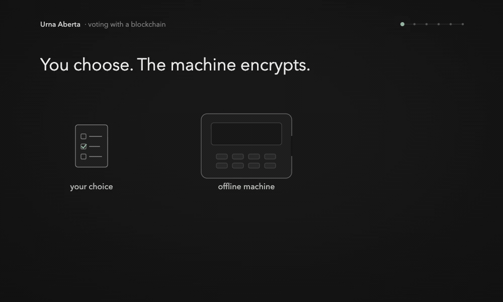

# Direct Publication

**The machine encrypts. The chain records. You verify.**

This prototype keeps the machine offline while you vote. It issues a signed receipt after selection but before CONFIRM or TEST; the receipt does not name the candidate. After polls close, the machine submits its signed batch directly to the contract. A signature protects authenticity and integrity under a trusted key, not voter intent; the same signed bytes verify identically if forwarded. Three of five trustees provide contributions for opening the encrypted sum, and a separate program checks supplied receipts and verifies the tally.

[Português brasileiro](README.pt-BR.md) · [Run the demo](#run-it) · [Study](#study)

[](docs/intro.mp4)

The animation above plays automatically and lasts 56 seconds. **[Open the video with pause and seeking](docs/intro.mp4).** Follow a ballot from receipt to verification. An illustrative animation with on-screen captions and no audio; `R7` is a symbolic code, not a real receipt.

## Who does what

1. **Offline machine: encrypts and issues the receipt.** After candidate selection but before CONFIRM or TEST, the machine issues the signed receipt. It reserves canonical batch byte capacity for either outcome first; an honest machine rejects a full next ballot without issuing a receipt and preserves earlier accepted ballots. This is not persistent crash recovery. `CONFIRM` keeps the ballot encrypted and casts it. `TEST` opens the ballot and spoils it. Cryptography rejects an invalid opening, but a valid opening of a different choice is detectable only by an independent comparison with remembered intent.
2. **Blockchain: records signed batches.** After polls close, the machine submits its batch directly. The Solidity contract checks the signature and accepts one batch per registered machine within the deadline. A poll worker enables that simulated connection after close; the voting software cannot turn it on early. Ballot proofs are checked outside the contract. The demo's blockchain is a local Anvil node. Forwarding the exact signed bytes does not change their signature validity; this does not mean an intermediary adds or removes cryptographic integrity.
3. **Trustees: contribute to opening the sum.** Three of five distinct trustees must submit matching aggregate digests before the contract pins the digest. The flow does not publish openings of confirmed ballots.
4. **Independent verifier: checks receipts and results.** Using public files and supplied receipts, it checks inclusion, signatures, ballot proofs and the tally. A missing supplied receipt fails verification; test ballots do not count. Invalid trustee contributions are excluded and listed when at least three valid matching contributions remain; this is a valid-tally proof with reported invalid contributions, not proof that every transcript contribution was valid.

**Brazilian context.** The TSE documents publication of polling-station totals, digital vote records and logs for auditing. The polling-station bulletin reports totals rather than identifying an individual ballot. [Context and official sources](docs/media.md#brazilian-system-context).

## Real execution in the terminal


Historical baseline recording: two machines, six confirmed ballots, one spoiled test, and tally `(2, 2, 2)`, played at **3×** speed. Receipts and results shown are from that recorded run, not fresh results for current changes. [VHS tape](docs/demo.tape) · [Reproduce the recording](docs/media.md).

## Run it

Install Python 3.12, uv 0.11.7, Foundry 1.8.5 (`forge` and `anvil`), and solc 0.8.28.

```sh
uv sync --locked
make demo
```

`make demo` compiles the contract, starts an Anvil node for that run, and prints the verifier's tally. The checked-in timings, gas and notebook results are historical baseline evidence from commit `f8d9358`; they are not fresh benchmarks of the current working tree. See [`demo/results/measurements.json`](demo/results/measurements.json) and [`demo/notebook.ipynb`](demo/notebook.ipynb).

To run the standalone verifier on the bundled synthetic baseline, use the repository root:

```sh
.venv/bin/python -m verifier.cli --manifest demo/results/manifest.json --evidence demo/results/evidence.json --receipts demo/results/receipts.json
```

This checks the supplied files against each other. It does not establish their authentic source, and inclusion is not proof that the ballot reflects the voter's intended candidate.

### Docker Compose

Compose starts Anvil and the demo on an internal network, with no published ports and no host volumes. It starts only after you attest that the environment is an isolated private VM with no host mounts. Use a disposable environment. The Anvil seed in the file is public test material.

```sh
RUN_ID="$(python3 -c 'import uuid; print(uuid.uuid4().hex)')" && \
URNA_COMPOSE_RUN_ID="$RUN_ID" \
URNA_COMPOSE_ISOLATED_PRIVATE_VM=true \
URNA_COMPOSE_NO_HOST_MOUNTS=true \
docker compose -p "urna-aberta-$RUN_ID" up --build --abort-on-container-exit --exit-code-from demo
```

On ARM, image build uses amd64 emulation for the Solidity compiler step. Python and Anvil run natively. The recorded mount-free local VM example finished with two confirmed ballots and tally `(1, 1)`; this is historical example evidence, not a fresh run.

## What the demo catches

`make attacks` runs all eight. Each command builds the failure and exits 0 only when the check catches it.

| Failure | What is caught | Command |
| --- | --- | --- |
| Machine substitution | Rejects an invalid opening; a valid opening of a different choice is detected only by comparing it with independently remembered intent | [`attacks/machine.py`](attacks/machine.py), `make attack-machine` |
| Edited transport | Signed bytes that no longer match, rejected by the contract | [`attacks/transport.py`](attacks/transport.py), `make attack-transport` |
| Dropped ballot | A receipt missing from a resigned batch | [`attacks/drop_vote.py`](attacks/drop_vote.py), `make attack-drop-vote` |
| False tally | An announced total that disagrees with verification | [`attacks/tally.py`](attacks/tally.py), `make attack-tally` |
| Second batch | The same machine posting again | [`attacks/duplicate.py`](attacks/duplicate.py), `make attack-duplicate` |
| Unknown machine | A signer that was never registered | [`attacks/rogue_machine.py`](attacks/rogue_machine.py), `make attack-rogue-machine` |
| Two choices | A ballot with two selected candidates | [`attacks/double_vote.py`](attacks/double_vote.py), `make attack-double-vote` |
| Early network | Transport enabled before the poll closes | [`attacks/early_network.py`](attacks/early_network.py), `make attack-early-network` |

## What the board is for

The board is the public log of signed batches and trustee shares. The contract accepts one batch from each registered machine and rejects a repeat, an unknown signer, or edited bytes. Ballot proofs are checked by the verifier. Anyone can run it on the published files.

A replicated database can store the same bytes. The chain makes the inclusion rule explicit and replayable. The demo's Anvil node is local. It runs the real contract. It is one process, so it does not stand in for independent validators, and a copied JSON file does not prove that a network reached consensus. A machine signature authenticates bytes under its trusted key; it does not attest to voter intent or add integrity when the same signed bytes are forwarded.

## How far this goes

- The key dealer is trusted, and the demo holds all five shares. Three trustees who pool shares can read individual ballots. The public API returns the audited tally.
- The switch, the seal, the reinstall, and the hash check run in a scratch directory. They model the ritual. The receipt proves that this machine signed this ballot. The short 80-bit prefix only finds it. The full hash and the signature decide.
- There is no voter roll. The machine accepts another well-formed ballot. Eligibility, turnout, and coercion sit outside this code.
- `TEST` publicly reveals the tested choice and randomness. An invalid cryptographic opening is rejected, but a valid opening for a substituted choice passes cryptography; detection requires an independent comparison with the voter's remembered intent. There has been no usability or accessibility trial, and the demo does not test untested ballots. If challenges are independent and unpredictable after receipt, the plotted expression `1 - (1 - p)^k` is a statistical model, not empirical evidence or a guarantee.
- A manifest allows at most 16 machines, 1000 ballots on each, and a tally of 16000. These prototype bounds do not establish national-scale performance.
- Direct publication uses the finalized in-memory batch. Failure to create an optional carrier copy produces a warning, not a publication prerequisite. This is not recovery from network failure or loss of the machine's memory.
- The board pins an aggregate digest after three distinct matching trustee submissions. The verifier can report and exclude invalid trustee contributions if at least three valid matching contributions remain; it still stops without totals on ballot, batch, receipt or event-integrity errors.

The design and the trust boundary are in [`docs/architecture.md`](docs/architecture.md) and [`docs/threat-model.md`](docs/threat-model.md).

## Study

João Henrique Menezes Silva Boia, *Direct Publication for Offline Ballots: An Executable Research Prototype* (October 2026). The arXiv submission/link is pending; it has not been submitted. The source is [`paper/main.tex`](paper/main.tex).

It is an independent study, not a journal article. `make paper` rebuilds the PDF with Tectonic 0.17.0 from [`paper/main.tex`](paper/main.tex), [`paper/refs.bib`](paper/refs.bib), and [`paper/figures/evaluation.py`](paper/figures/evaluation.py).
