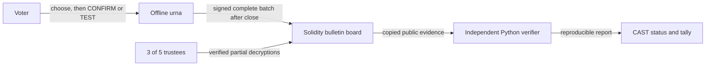

# Urna Aberta

**Voting machines that prove their own result, without trusting anyone.**

That line is an educational vision, not a literal trust-free guarantee. This research prototype has explicit trust assumptions: a trusted election manifest and central dealer, trustees, machine software and host, and an honest complete board export. It does not prove that a real device or operating system ran approved code, prevent coercion, or provide production election security. See [architecture](docs/architecture.md) and [threat model](docs/threat-model.md).

[](.github/workflows/ci.yml) [](LICENSE) [](#paper)

CI is configured in the linked workflow; it has not been remotely executed. Badges identify configuration and license, not a passing remote build or published paper.


The GIF is an actual VHS capture. Its regeneration recipe is [`docs/demo.tape`](docs/demo.tape); it runs `uv run python -m demo.capture` and waits 90 seconds. Capture prerequisites and cache state affect duration.

## How it works in 3 steps

1. **Prepare and choose:** the offline machine prints a signed receipt before the voter confirms a ballot or selects `TEST`. A tested ballot is spoiled and reveals its opening; a confirmed ballot does not publish its randomness.
2. **Publish:** after close, each registered machine signs and posts one complete batch to the append-only Solidity bulletin board. The demo uses a local Anvil chain.
3. **Verify:** trustees publish threshold decryption shares for the audited aggregate; the separate Python verifier checks the manifest, batches, ballot proofs, receipts, trustee proofs, and totals.



The diagram describes the prototype workflow, not independent real-world institutions. Three colluding trustees can decrypt individual ciphertexts; aggregate-only decryption is an API policy, not cryptographic prevention. The demo process holds all five shares.

## Quickstart

### Docker Compose

Run only inside a genuinely isolated, disposable private VM that you own, with no host mounts. The two `true` values are operator attestations required by Compose, not isolation enforcement. Do not use production keys, a production chain, or an exposed network. The Anvil seed is public test material.

```sh
RUN_ID="$(python3 -c 'import uuid; print(uuid.uuid4().hex)')" && \
URNA_COMPOSE_RUN_ID="$RUN_ID" \
URNA_COMPOSE_ISOLATED_PRIVATE_VM=true \
URNA_COMPOSE_NO_HOST_MOUNTS=true \
docker compose -p "urna-aberta-$RUN_ID" up --build --abort-on-container-exit --exit-code-from demo
```

This starts an internal network with no published ports or host volumes. The command may download images and build the image. On ARM, the image uses amd64 emulation for the Solidity compiler build step only; Python and Anvil run natively. The local Compose election was executed successfully in a verified mount-free disposable VM: two CAST ballots, tally `(1, 1)`, and exit code 0. This is local runtime evidence, not remote CI or independent-institution certification.

### Native development

Install Python 3.12, `uv` 0.11.7, Foundry 1.8.5 (`forge` and `anvil`), and Solidity 0.8.28 (`solc`). Then:

```sh
uv sync --locked
make demo
```

`make demo` builds the contract and runs the end-to-end demo against its own local Anvil child. Commands create project-local dependencies and temporary demo output. Do not point tools at a shared or production chain. The first complete demo took 56.5907 seconds in the recorded setup; two later fresh-process/fresh-node runs took 56.1745 and 56.1649 seconds. These timings exclude tool installation and first Docker image download/build, and are not a two-minute guarantee. See [`demo/results/measurements.json`](demo/results/measurements.json) for raw samples and environment.

## Attack demonstrations

Each command demonstrates detection of the named fault. They are local demonstrations, not proof against all attacks.

| Attack | Demonstration | Command |
| --- | --- | --- |
| Malicious machine / false TEST opening | An opening that disagrees with the encrypted choice is rejected | [`attacks/machine.py`](attacks/machine.py), `make attack-machine` |
| Tampered transport | Edited signed bytes fail validation and the actual contract rejects them | [`attacks/transport.py`](attacks/transport.py), `make attack-transport` |
| Dropped vote | A retained receipt missing from a resigned batch is detected | [`attacks/drop_vote.py`](attacks/drop_vote.py), `make attack-drop-vote` |
| False tally | Announced totals differing from verification are rejected | [`attacks/tally.py`](attacks/tally.py), `make attack-tally` |
| Duplicate batch | The contract rejects a second batch from one machine | [`attacks/duplicate.py`](attacks/duplicate.py), `make attack-duplicate` |
| Rogue machine | The contract rejects an unregistered signer | [`attacks/rogue_machine.py`](attacks/rogue_machine.py), `make attack-rogue-machine` |
| Double vote | The exactly-one proof rejects a ballot with two one-bits | [`attacks/double_vote.py`](attacks/double_vote.py), `make attack-double-vote` |
| Early network | The application cannot enable simulated transport before close | [`attacks/early_network.py`](attacks/early_network.py), `make attack-early-network` |

Run all eight with `make attacks`. They use local fixtures and owned Anvil children where needed; do not target any other chain.

## Why a blockchain, rather than a replicated database?

The board illustrates a public, append-only interface for signed machine batches and trustee submissions, with a reproducible snapshot hash. A conventional replicated database could provide similar logging and access control with less complexity. The contract does not validate ballot zero-knowledge proofs, provide data availability beyond its events, or create institutional independence. Anvil is a local single-node simulator, not consortium consensus or finality. Reorganizations, censorship, unavailable RPCs, gas costs, calldata and block-size limits remain relevant on a real network. Several nodes on one computer are not independent validators; institutions would need to operate and audit independent validators. Trustees are not automatically ledger validators.

## Limitations and trust assumptions

- **Setup:** the verifier relies on a trusted manifest and a trusted central dealer. There is no distributed key generation. The demo process possesses all five trustee shares. Any three colluding trustees can decrypt arbitrary ciphertexts, even though the public wrapper only releases a final audited aggregate.
- **Device and seal:** physical switch, power-off transport, wipe/reinstall and hash checks are scratch simulations, not physical isolation, secure boot, OS attestation or secure erasure. Hash checks precede demo votes but do not attest to the executed OS or dependencies. A receipt is signed before the decision and does not prove a physical button press. Its short 80-bit lookup prefix is only a locator; the complete hash and signature are required.
- **Ballot integrity and privacy:** the toy machine accepts multiple valid ballots without voter credentials. Eligibility, turnout reconciliation, ballot stuffing prevention and one-person-one-vote are not implemented. TEST reveals the choice and randomness; coercion, challenge participation and unpredictable challenge selection are unresolved. Malicious software could log secrets; Python is not constant-time.
- **Evidence and chain:** copied JSON is checked under the assumption that it is an authentic, honest, complete export. It is not a light client or consensus proof. The append-only contract can be reset by its Anvil operator; local single-node execution is not consortium finality. The first invalid trustee aggregate pin can permanently deny service. Any invalid submitted proof aborts verification. No ballot proof is verified on chain.
- **Scale and operations:** the prototype caps elections at 16 machines and tally at 16,000. Availability, censorship, reorganization, gas, calldata and block limits make no national-scale claim. Legal adoption, deployment governance, independent validation and operational security are outside scope.
- **Detection probability:** the [challenge chart](docs/figures/challenge-probability.png) uses the analytic expression `1 - (1 - p)^k`. It assumes independent, unpredictable TEST decisions made after commitment; it is not measured empirical protection or a guarantee.

Performance values are measurements from one recorded setup, not security evidence or a service-level promise. Full raw JSON samples, gas receipts, payload sizes, proof bytes, provenance and verifier report are in [`demo/results/`](demo/results/). No cryptographic primitive or novelty guarantee is claimed.

## Paper

<!-- BEGIN paper -->
Paper source is being prepared. No paper PDF or publication link is available yet.
<!-- END paper -->

Citation metadata is provided in [`CITATION.cff`](CITATION.cff). The paper section will be updated when the paper is available.
