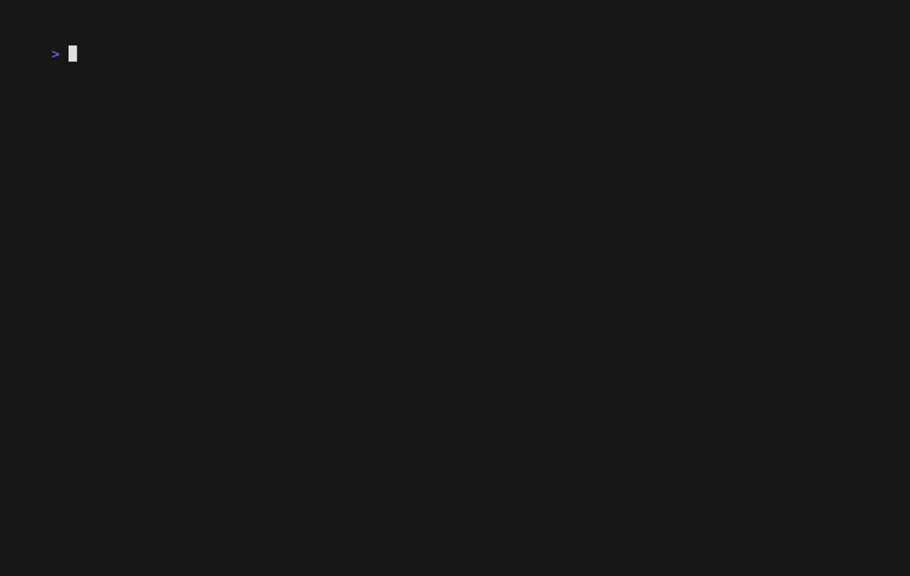
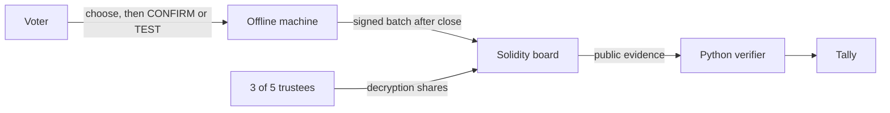

# Urna Aberta

**Voting machines that prove their own result, without trusting anyone.**

Educational prototype of an election you can check. You choose a candidate. The offline machine prints a signed receipt before you confirm or test the ballot. Confirmed ballots leave encrypted, shuffled, and without a timestamp. A separate program reads the public board and recomputes the tally.

[](.github/workflows/ci.yml) [](LICENSE) [](paper/main.pdf)



The animation is a real VHS capture of that demo. The recipe is [`docs/demo.tape`](docs/demo.tape).

## Three steps

1. **Vote.** The machine encrypts the choice and prints the receipt first. `CONFIRM` keeps the opening secret and casts the ballot. `TEST` opens it, spoils that ballot, and lets you vote again.
2. **Publish.** After the poll closes, each registered machine signs one complete batch and posts it to the Solidity board. The demo runs the board on a local Anvil node.
3. **Check.** Three of five trustees publish decryption shares for the audited total. The Python verifier checks the manifest, signatures, ballot proofs, receipts, trustee proofs, and the tally. Spoiled ballots stay out.



In the measured demo, two machines cast six ballots and spoil one test across three candidates. The public verifier finds the receipt and reports `(2, 2, 2)`.

## Run it

Install Python 3.12, uv 0.11.7, Foundry 1.8.5 (`forge` and `anvil`), and solc 0.8.28.

```sh
uv sync --locked
make demo
```

`make demo` compiles the contract, starts an Anvil node for that run, and prints the verifier's tally. Three fresh runs on the measured machine took 56.5907 s, 56.1745 s, and 56.1649 s, not counting tool installation. The samples are in [`demo/results/measurements.json`](demo/results/measurements.json).

The same evidence, already executed, is in [`demo/notebook.ipynb`](demo/notebook.ipynb).

### Docker Compose

Compose starts Anvil and the demo on an internal network, with no published ports and no host volumes. It starts only after you attest that the environment is an isolated private VM with no host mounts. Use a disposable environment. The Anvil seed in the file is public test material.

```sh
RUN_ID="$(python3 -c 'import uuid; print(uuid.uuid4().hex)')" && \
URNA_COMPOSE_RUN_ID="$RUN_ID" \
URNA_COMPOSE_ISOLATED_PRIVATE_VM=true \
URNA_COMPOSE_NO_HOST_MOUNTS=true \
docker compose -p "urna-aberta-$RUN_ID" up --build --abort-on-container-exit --exit-code-from demo
```

On ARM, image build uses amd64 emulation for the Solidity compiler step. Python and Anvil run natively. A verified run in a mount-free local VM finished with two confirmed ballots and tally `(1, 1)`.

## What the demo catches

`make attacks` runs all eight. Each command builds the failure and exits 0 only when the check catches it.

| Failure | What is caught | Command |
| --- | --- | --- |
| Lying machine | A test opening that disagrees with the encrypted choice | [`attacks/machine.py`](attacks/machine.py), `make attack-machine` |
| Edited transport | Signed bytes that no longer match, rejected by the contract | [`attacks/transport.py`](attacks/transport.py), `make attack-transport` |
| Dropped ballot | A receipt missing from a resigned batch | [`attacks/drop_vote.py`](attacks/drop_vote.py), `make attack-drop-vote` |
| False tally | An announced total that disagrees with verification | [`attacks/tally.py`](attacks/tally.py), `make attack-tally` |
| Second batch | The same machine posting again | [`attacks/duplicate.py`](attacks/duplicate.py), `make attack-duplicate` |
| Unknown machine | A signer that was never registered | [`attacks/rogue_machine.py`](attacks/rogue_machine.py), `make attack-rogue-machine` |
| Two choices | A ballot with two selected candidates | [`attacks/double_vote.py`](attacks/double_vote.py), `make attack-double-vote` |
| Early network | Transport enabled before the poll closes | [`attacks/early_network.py`](attacks/early_network.py), `make attack-early-network` |

## What the board is for

The board is the public log of signed batches and trustee shares. The contract accepts one batch from each registered machine and rejects a repeat, an unknown signer, or edited bytes. Ballot proofs are checked by the verifier. Anyone can run it on the published files.

A replicated database can store the same bytes. The chain makes the inclusion rule explicit and replayable. The demo's Anvil node is local. It runs the real contract. It is one process, so it does not stand in for independent validators, and a copied JSON file does not prove that a network reached consensus.

## How far this goes

- The key dealer is trusted, and the demo holds all five shares. Three trustees who pool shares can read individual ballots. The public API returns the audited tally.
- The switch, the seal, the reinstall, and the hash check run in a scratch directory. They model the ritual. The receipt proves that this machine signed this ballot. The short 80-bit prefix only finds it. The full hash and the signature decide.
- There is no voter roll. The machine accepts another well-formed ballot. Eligibility, turnout, and coercion sit outside this code.
- `TEST` prints the choice and the randomness. If tests are independent and unpredictable after the receipt exists, the chance of catching a lying machine is `1 - (1 - p)^k`, plotted in [`docs/figures/challenge-probability.png`](docs/figures/challenge-probability.png).
- A manifest allows at most 16 machines, 1000 ballots on each, and a tally of 16000. The paper's arithmetic for 500000 machines and 150 million voters extrapolates these measurements under the hypotheses written there.
- A wrong trustee pin freezes the aggregate. Verification stops at the first bad proof.

The design and the trust boundary are in [`docs/architecture.md`](docs/architecture.md) and [`docs/threat-model.md`](docs/threat-model.md).

## Paper

<!-- BEGIN paper -->
The paper records the protocol, the eight attacks, and the measurements: [`paper/main.pdf`](paper/main.pdf). Sources: [`paper/main.tex`](paper/main.tex), [`paper/refs.bib`](paper/refs.bib), and [`paper/figures/evaluation.py`](paper/figures/evaluation.py). With Tectonic 0.17.0 installed, `uv sync --locked` and `make paper` rebuild the PDF. The LNCS class and bibliography style are in the repository. Collective authorship. This is an educational manuscript, not a peer-reviewed publication.
<!-- END paper -->

Citation metadata: [`CITATION.cff`](CITATION.cff). *Urna Aberta contributors. Urna Aberta: An Offline Ballot Protocol with Publicly Checkable Evidence.*
