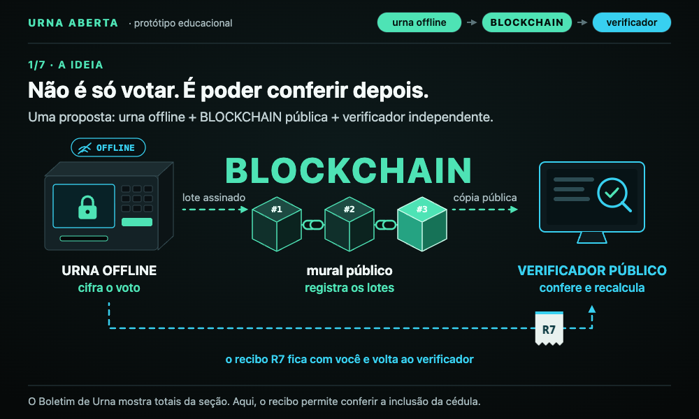
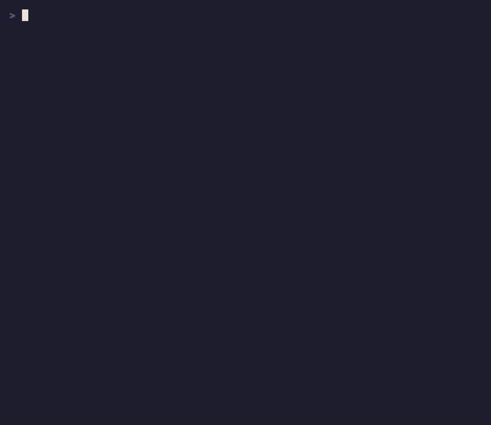

# Urna Aberta

**A urna cifra. A blockchain registra. Você confere.**

Neste protótipo educacional, você vota numa urna offline e recebe um recibo sem o nome do candidato. Só no encerramento os lotes assinados seguem para um contrato na blockchain. Depois, um programa independente confere seu recibo e recalcula a apuração com as provas publicadas.

[English](README.md) · [Rodar a demo](#rodar) · [Artigo](paper/main.pdf)

[](docs/intro.pt-BR.mp4)

**[Assistir à explicação: 56 segundos, com pausa e avanço](docs/intro.pt-BR.mp4).** Acompanhe uma cédula do recibo até a conferência. Animação ilustrativa com legendas na imagem, sem áudio; `R7` é um código simbólico, não um recibo real.

## Quem faz o quê

1. **Urna offline: cifra e emite o recibo.** O recibo sai antes da decisão. `CONFIRM` mantém a cédula cifrada e registra o voto. `TEST` abre a cédula para conferir a escolha, anula essa cédula e exige um novo voto.
2. **Blockchain: registra os lotes assinados.** Depois do encerramento, cada urna envia seu lote em uma transação. O contrato Solidity confere a assinatura e aceita um único lote por urna registrada, dentro do prazo. As provas dos votos são conferidas fora do contrato. Na demo, a blockchain é um nó Anvil local.
3. **Guardiões: abrem a soma.** Três de cinco participantes que guardam partes da chave publicam suas contribuições para decifrar o total auditado. O fluxo não publica a abertura dos votos confirmados.
4. **Verificador independente: confere recibos e resultado.** Com os arquivos públicos e o seu recibo, ele verifica inclusão, assinaturas, provas e apuração. Se um recibo fornecido estiver ausente, a conferência acusa; cédulas de teste não entram na contagem.

**O que muda?** O Boletim de Urna brasileiro permite comparar os totais da seção com os publicados pelo TSE. Ele não é um recibo individual da cédula. A proposta acrescenta a conferência por recibo e as provas verificáveis da apuração. [Contexto e fontes oficiais](docs/media.md#brazilian-system-context).

## Execução real no terminal



Duas urnas, seis votos confirmados, um teste anulado e apuração `(2, 2, 2)`. Captura real de uma execução local, reproduzida a **3×**. Recibos e resultados vêm dessa execução, não de texto encenado. [Roteiro VHS](docs/demo.pt-BR.tape) · [Como reproduzir a gravação](docs/media.md).

## Rodar

Instale Python 3.12, uv 0.11.7, Foundry 1.8.5 (`forge` e `anvil`) e solc 0.8.28.

```sh
uv sync --locked
make demo DEMO_LANG=pt-BR
```

`make demo` compila o contrato, sobe um Anvil só dessa execução e imprime a apuração do verificador. Nas três execuções do checkpoint medido, do zero, os tempos foram 56.5907 s, 56.1745 s e 56.1649 s, sem contar a instalação das ferramentas. As amostras estão em [`demo/results/measurements.json`](demo/results/measurements.json).

A mesma evidência, já executada, está em [`demo/notebook.ipynb`](demo/notebook.ipynb).

### Docker Compose

O Compose sobe o Anvil e a demo numa rede interna, sem portas publicadas e sem volumes do host. Só inicia depois que você declara que o ambiente é uma VM privada isolada, sem montagens do host. Use um ambiente descartável. A semente do Anvil no arquivo é material público de teste.

```sh
RUN_ID="$(python3 -c 'import uuid; print(uuid.uuid4().hex)')" && \
URNA_COMPOSE_RUN_ID="$RUN_ID" \
URNA_COMPOSE_ISOLATED_PRIVATE_VM=true \
URNA_COMPOSE_NO_HOST_MOUNTS=true \
docker compose -p "urna-aberta-$RUN_ID" up --build --abort-on-container-exit --exit-code-from demo
```

Em ARM, a imagem usa emulação amd64 só na etapa do compilador Solidity. Python e Anvil rodam nativos. Uma execução verificada, numa VM local sem montagens, terminou com dois votos confirmados e apuração `(1, 1)`.

## O que a demo pega

`make attacks` roda as oito. Cada comando monta a falha e só termina bem quando a conferência pega.

| Falha | O que aparece | Comando |
| --- | --- | --- |
| Urna mentirosa | Abertura de teste que não bate com a escolha cifrada | [`attacks/machine.py`](attacks/machine.py), `make attack-machine` |
| Transporte alterado | Bytes assinados que deixaram de bater, recusados pelo contrato | [`attacks/transport.py`](attacks/transport.py), `make attack-transport` |
| Voto sumido | Recibo que falta num lote reassinado | [`attacks/drop_vote.py`](attacks/drop_vote.py), `make attack-drop-vote` |
| Apuração falsa | Total anunciado diferente do total conferido | [`attacks/tally.py`](attacks/tally.py), `make attack-tally` |
| Segundo lote | A mesma urna publicando de novo | [`attacks/duplicate.py`](attacks/duplicate.py), `make attack-duplicate` |
| Urna desconhecida | Assinatura de quem não foi registrado | [`attacks/rogue_machine.py`](attacks/rogue_machine.py), `make attack-rogue-machine` |
| Duas escolhas | Cédula com dois candidatos marcados | [`attacks/double_vote.py`](attacks/double_vote.py), `make attack-double-vote` |
| Rede cedo | Transporte habilitado antes do encerramento | [`attacks/early_network.py`](attacks/early_network.py), `make attack-early-network` |

## Para que serve o mural

O mural é o registro público dos lotes assinados e das partes dos trustees. O contrato aceita um lote de cada urna registrada e recusa repetição, assinante desconhecido ou bytes alterados. As provas das cédulas ficam com o verificador. Qualquer pessoa roda esse verificador nos arquivos publicados.

Um banco replicado também guardaria esses bytes. A blockchain deixa a regra de inclusão explícita e repetível. O Anvil da demo é local. Ele executa o contrato de verdade. É um processo só, então não faz o papel de validadores independentes, e um JSON copiado não prova que uma rede chegou a consenso.

## Até onde isto vai

- O dealer das chaves é confiável, e a demo guarda as cinco partes. Três trustees que juntarem as partes leem votos individuais. A API pública devolve a apuração auditada.
- Interruptor, lacre, reinstalação e verificação de hash rodam num diretório temporário. Modelam o ritual. O recibo prova que aquela urna assinou aquela cédula. O prefixo curto de 80 bits só serve para achar. Decidem o hash completo e a assinatura.
- Não há lista de eleitores. A urna aceita outra cédula bem formada. Elegibilidade, comparecimento e coerção ficam fora deste código.
- `TEST` mostra a escolha e a aleatoriedade. Se os testes forem independentes e imprevisíveis depois do recibo, a chance de pegar uma urna que mente é `1 - (1 - p)^k`, no gráfico [`docs/figures/challenge-probability.png`](docs/figures/challenge-probability.png).
- Um manifesto aceita no máximo 16 urnas, 1000 cédulas em cada e apuração até 16000. A conta do artigo para 500000 urnas e 150 milhões de eleitores extrapola estas medições, com as hipóteses escritas lá.
- Um pin errado de trustee trava o agregado. A verificação para na primeira prova inválida.

O desenho e o limite de confiança estão em [`docs/architecture.md`](docs/architecture.md) e [`docs/threat-model.md`](docs/threat-model.md).

## Artigo

<!-- BEGIN paper -->
O artigo registra o protocolo, os oito ataques e as medições: [`paper/main.pdf`](paper/main.pdf). Fontes em [`paper/main.tex`](paper/main.tex), [`paper/refs.bib`](paper/refs.bib) e [`paper/figures/evaluation.py`](paper/figures/evaluation.py). Com Tectonic 0.17.0 instalado, `uv sync --locked` e `make paper` recompilam o PDF. A classe LNCS e o estilo bibliográfico estão no repositório. Autoria coletiva. É um manuscrito educacional, não uma publicação revisada por pares.
<!-- END paper -->

Metadados de citação: [`CITATION.cff`](CITATION.cff). *Urna Aberta contributors. Urna Aberta: An Offline Ballot Protocol with Publicly Checkable Evidence.*
