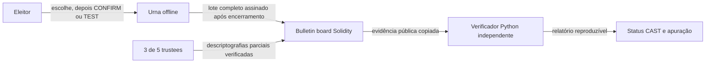

# Urna Aberta

**Máquinas de votação que provam seu próprio resultado, sem confiar em ninguém.**

Essa frase expressa uma visão educacional, não uma garantia literal sem confiança. Este protótipo de pesquisa tem pressupostos explícitos de confiança: manifesto eleitoral e distribuidor central confiáveis, trustees, software da máquina e host, e uma exportação completa e honesta do registro. Ele não prova que um dispositivo ou sistema operacional real executou código aprovado, não impede coerção e não oferece segurança para eleições de produção. Consulte a [arquitetura](docs/architecture.md) e o [modelo de ameaças](docs/threat-model.md).

[](.github/workflows/ci.yml) [](LICENSE) [](paper/main.pdf)

A CI está configurada no workflow vinculado; ela não foi executada remotamente. Os badges identificam configuração e licença, não uma compilação remota aprovada nem um artigo publicado.


O GIF é uma captura real com VHS. A receita para reproduzi-la está em [`docs/demo.tape`](docs/demo.tape); ela executa `uv run python -m demo.capture` e aguarda 90 segundos. Os pré-requisitos e o estado do cache afetam a duração.

## Como funciona em 3 etapas

1. **Preparar e escolher:** a máquina offline imprime um recibo assinado antes de a pessoa confirmar a cédula ou selecionar `TEST`. A cédula testada é anulada e revela sua abertura; uma cédula confirmada não publica sua aleatoriedade.
2. **Publicar:** depois do encerramento, cada máquina registrada assina e publica um lote completo na bulletin board Solidity append-only. A demonstração usa uma blockchain local Anvil.
3. **Verificar:** trustees publicam partes de descriptografia limiar para o agregado auditado; o verificador Python separado confere manifesto, lotes, provas das cédulas, recibos, provas dos trustees e totais.



O diagrama descreve o fluxo do protótipo, não instituições independentes no mundo real. Três trustees em conluio podem descriptografar cifras individuais; a descriptografia apenas do agregado é uma política da API, não uma impossibilidade criptográfica. O processo de demonstração possui as cinco partes.

## Início rápido

### Docker Compose

Execute somente dentro de uma VM privada, descartável e realmente isolada que você controla, sem montagens do host. Os dois valores `true` são declarações do operador exigidas pelo Compose, não mecanismos de isolamento. Não use chaves de produção, blockchain de produção nem uma rede exposta. A semente Anvil é material público de teste.

```sh
RUN_ID="$(python3 -c 'import uuid; print(uuid.uuid4().hex)')" && \
URNA_COMPOSE_RUN_ID="$RUN_ID" \
URNA_COMPOSE_ISOLATED_PRIVATE_VM=true \
URNA_COMPOSE_NO_HOST_MOUNTS=true \
docker compose -p "urna-aberta-$RUN_ID" up --build --abort-on-container-exit --exit-code-from demo
```

Isso inicia uma rede interna, sem portas publicadas nem volumes do host. O comando pode baixar imagens e compilar a imagem. Em ARM, usa emulação amd64 apenas na etapa de compilação do compilador Solidity; Python e Anvil rodam nativamente. A eleição local do Compose foi executada com sucesso em uma VM descartável sem montagens, com isolamento verificado: duas cédulas CAST, apuração `(1, 1)` e código de saída 0. Isso é evidência de execução local, não CI remota nem certificação de instituições independentes.

### Desenvolvimento nativo

Instale Python 3.12, `uv` 0.11.7, Foundry 1.8.5 (`forge` e `anvil`) e Solidity 0.8.28 (`solc`). Depois:

```sh
uv sync --locked
make demo
```

`make demo` compila o contrato e executa a demonstração de ponta a ponta em seu próprio processo filho Anvil local. Os comandos criam dependências no projeto e arquivos temporários de saída da demonstração. Não configure as ferramentas para usar uma blockchain compartilhada ou de produção. A primeira demonstração completa levou 56.5907 segundos no ambiente medido; duas execuções posteriores, cada uma em processo e nó novos, levaram 56.1745 e 56.1649 segundos. Esses tempos não incluem instalação de ferramentas nem o primeiro download/compilação da imagem Docker e não são uma promessa de duração inferior a dois minutos. Consulte [`demo/results/measurements.json`](demo/results/measurements.json) para amostras brutas e ambiente.

## Demonstrações de ataques

Cada comando demonstra a detecção da falha indicada. São demonstrações locais, não provas contra todos os ataques.

| Ataque | Demonstração | Comando |
| --- | --- | --- |
| Máquina maliciosa / abertura TEST falsa | Rejeita uma abertura incompatível com a escolha cifrada | [`attacks/machine.py`](attacks/machine.py), `make attack-machine` |
| Transporte adulterado | Bytes assinados alterados falham na validação e o contrato real os rejeita | [`attacks/transport.py`](attacks/transport.py), `make attack-transport` |
| Voto omitido | Detecta recibo retido ausente de um lote reassinado | [`attacks/drop_vote.py`](attacks/drop_vote.py), `make attack-drop-vote` |
| Apuração falsa | Rejeita totais anunciados diferentes dos totais verificados | [`attacks/tally.py`](attacks/tally.py), `make attack-tally` |
| Lote duplicado | O contrato rejeita um segundo lote da mesma máquina | [`attacks/duplicate.py`](attacks/duplicate.py), `make attack-duplicate` |
| Máquina não registrada | O contrato rejeita um signatário não registrado | [`attacks/rogue_machine.py`](attacks/rogue_machine.py), `make attack-rogue-machine` |
| Voto duplo | A prova de exatamente um rejeita uma cédula com dois bits iguais a um | [`attacks/double_vote.py`](attacks/double_vote.py), `make attack-double-vote` |
| Rede antecipada | O aplicativo não consegue habilitar o transporte simulado antes do encerramento | [`attacks/early_network.py`](attacks/early_network.py), `make attack-early-network` |

Execute as oito demonstrações com `make attacks`. Elas usam fixtures locais e processos Anvil próprios quando necessário; não as direcione a outra blockchain.

## Por que blockchain em vez de banco de dados replicado?

A bulletin board demonstra uma interface pública append-only para lotes assinados pelas máquinas e envios dos trustees, com hash de snapshot reproduzível. Um banco de dados replicado convencional poderia oferecer registro e controle de acesso semelhantes com menos complexidade. O contrato não valida provas de conhecimento zero das cédulas, não oferece disponibilidade dos dados além de seus eventos e não cria independência institucional. Anvil é um simulador local de nó único, não consenso ou finalização de um consórcio. Reorganizações, censura, indisponibilidade de RPC, custos de gas, calldata e limites de bloco continuam relevantes em uma rede real. Vários nós em um computador não são validadores independentes; instituições precisariam operar e auditar validadores independentes. Trustees não são automaticamente validadores do registro.

## Limitações e pressupostos de confiança

- **Configuração:** o verificador depende de um manifesto confiável e de um distribuidor central confiável. Não há geração distribuída de chaves. O processo de demonstração possui todas as cinco partes dos trustees. Três trustees em conluio podem descriptografar cifras arbitrárias, embora o wrapper público só libere o agregado final auditado.
- **Dispositivo e lacre:** chave física, transporte desligado, reinstalação/limpeza e verificações de hash são simulações em área temporária, não isolamento físico, secure boot, atestação do sistema operacional ou apagamento seguro. Verificações de hash precedem os votos da demonstração, mas não atestam o sistema operacional executado nem suas dependências. Um recibo é assinado antes da decisão e não prova o acionamento de um botão físico. Seu prefixo de busca de 80 bits é apenas um localizador; são necessários o hash completo e a assinatura.
- **Integridade e privacidade da cédula:** a máquina de brinquedo aceita várias cédulas válidas sem credenciais de eleitor. Elegibilidade, reconciliação de comparecimento, prevenção de enchimento de cédulas e regra de uma pessoa por voto não estão implementadas. `TEST` revela escolha e aleatoriedade; coerção, participação nos desafios e seleção imprevisível de desafios continuam sem solução. Software malicioso poderia registrar segredos; Python não é de tempo constante.
- **Evidência e blockchain:** o JSON copiado é verificado supondo-se que seja uma exportação autêntica, honesta e completa. Não é um cliente leve nem uma prova de consenso. O contrato append-only pode ser reiniciado pelo operador Anvil; execução local de nó único não é finalização de consórcio. O primeiro trustee a fixar um agregado inválido pode causar negação de serviço permanente. Qualquer prova inválida enviada interrompe a verificação. Nenhuma prova de cédula é verificada on-chain.
- **Escala e operação:** o protótipo limita eleições a 16 máquinas e apuração a 16.000. Disponibilidade, censura, reorganização, gas, calldata e limites de bloco não permitem alegar escala nacional. Adoção legal, governança de implantação, validação independente e segurança operacional estão fora do escopo.
- **Probabilidade de detecção:** o [gráfico de desafios](docs/figures/challenge-probability.png) usa a expressão analítica `1 - (1 - p)^k`. Ela pressupõe decisões `TEST` independentes e imprevisíveis, tomadas após o compromisso; não é proteção empírica medida nem garantia.

Os valores de desempenho são medições de um ambiente registrado, não evidência de segurança ou promessa de nível de serviço. Amostras JSON brutas, recibos de gas, tamanhos de payload, bytes de provas, proveniência e relatório do verificador estão em [`demo/results/`](demo/results/). Não alegamos primitivas criptográficas novas nem garantia de novidade.

## Artigo

<!-- BEGIN paper -->
**PDF do artigo de pesquisa:** [paper/main.pdf](paper/main.pdf) (autoria coletiva; projeto educacional, não uma publicação revisada por pares). Fontes: [LaTeX](paper/main.tex), [bibliografia](paper/refs.bib) e script reproduzível do gráfico [`paper/figures/evaluation.py`](paper/figures/evaluation.py). Instale Tectonic 0.17.0, execute `uv sync --locked` e recompile com `make paper`. A classe LNCS e o estilo bibliográfico estão incluídos.
<!-- END paper -->

Os metadados de citação estão em [`CITATION.cff`](CITATION.cff). Citação sugerida: *Urna Aberta contributors. Urna Aberta: An Offline Ballot Protocol with Publicly Checkable Evidence.* Manuscrito de pesquisa, projeto educacional.
