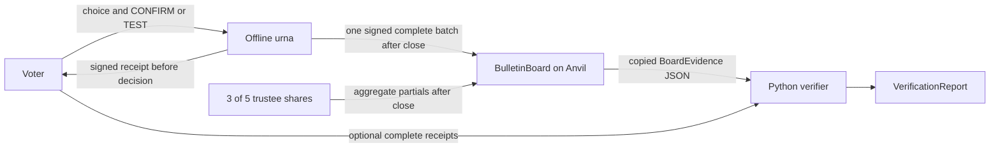

# Architecture

The implementation has three logical components: an offline voting machine, a Solidity bulletin board, and an independent Python verifier. This document describes those interfaces for *Direct Publication for Offline Ballots: An Executable Research Prototype*. It is not a production deployment design.

## Components and flow

### Offline urna

`urna.machine.VotingMachine` creates one ciphertext per candidate and a disjunctive Chaum-Pedersen proof for each bit, plus a sum proof that the vector contains exactly one selected candidate. Randomness uses cryptographic secrets. `prepare` prints a signed `Receipt` after selection but before the voter confirms or tests. Before issuing that receipt, it checks canonical byte capacity for either possible outcome, CAST or SPOILED. If the next ballot would exceed capacity, it rejects it without issuing a receipt; earlier accepted ballots remain. This is in-memory behavior, not persistent crash recovery. A `TEST` produces a `SpoiledBallot` containing the choice and encryption randomness for public opening verification; a confirmed ballot does not publish its randomness. `close` returns the cached, signed batch. The demo's physical switch, transport lock and reinstall/hash path are simulations in scratch state, not hardware enforcement.

Receipt signatures bind the election, chain, board, machine and ballot commitment. Under a trusted machine key, a signature authenticates and protects the integrity of those signed bytes; it does not prove voter intent. Forwarding the same signed bytes preserves a signature that verifies identically. The receipt's 20-hex-character (80-bit) lookup code is a convenience locator, not proof of uniqueness. Lookup must be unambiguous; the full commitment and signature are verified. The receipt is prepared before CONFIRM or TEST, so its signature alone does not prove a physical control was pressed or that the encrypted choice matches the voter's intent.

### Bulletin board

`contracts/src/BulletinBoard.sol` is an append-only program for registered machine batches and trustee partial submissions. Constructor parameters anchor an election, manifest hash, registries and deadlines. `postBatch` accepts at most one domain-bound signed batch per registered machine before the deadline, emits the full payload and folds its hash into `snapshotHash`. `postPartial` accepts registered trustees only after the batch deadline and before the partial deadline, requires the current snapshot and pins a nonzero aggregate digest after three distinct trustees submit that same digest. Before the pin, different digests are permitted; after it, mismatches are rejected. The pin is not checked for mathematical correctness on-chain.

The contract checks machine signatures and registry/deadline rules. It does not parse batches or verify ballot proofs, opening proofs or threshold proofs. It has no on-chain zero-knowledge verification. Anvil is an ephemeral local single-node chain; an operator can reset it. The snapshot hash is not consortium consensus, finality, data availability, or an independent timestamp.

### Independent verifier

The Python verifier consumes a trusted `ElectionManifest`, board evidence reconstructed from contract events, and optional voter receipts. It checks manifest and registry binding, canonical payloads, machine signatures, snapshot folding, batch/receipt consistency, CAST and SPOILED separation, ballot proofs, spoiled openings, trustee registration and partial-decryption proofs, then derives and checks the tally. Corrupt event hashes, duplicate trustee identities and ballot/batch/receipt errors remain fatal. Invalid trustee payloads or proofs are excluded and their indices are reported in optional `VerificationReport.rejected_trustees`; at least three distinct valid matching partials are required. This establishes a valid tally from the supplied valid threshold contributions, not an all-valid-transcript proof. `trustees.api.partial_for_final_tally` audits the closed board before creating a partial for its CAST aggregate.

The offline evidence interface assumes the JSON is an authentic, honest, complete export. It is not a light client, RPC finality proof or consensus verifier. The verifier can establish internal consistency under its supplied anchors; it cannot establish who supplied those anchors or whether the export omits chain history.

The optional exported carrier is published by staging in the destination directory, flushing and syncing the file, then creating an exclusive hard link at the destination. Existing destination paths are not overwritten; cleanup removes only the staging path. This does not guarantee parent-directory durability or survival of power loss, and cannot protect against loss of every copy. The carrier itself does not provide the machine-account credential for board publication. The direct demo submits the finalized in-memory batch before attempting the optional copy. Copy failure is reported in stderr and `carrier_warnings`, while direct publication continues. This is not a new relay, durable machine journal, or recovery from network failure.

## Cryptographic and data boundaries

- The prototype uses RFC 3526 group 14 with `g=2`, Exponential ElGamal, per-candidate ciphertexts, bit proofs, and an exactly-one sum proof. These are integrations of established constructions, not new cryptographic primitives or a formal security proof.
- Setup uses a trusted dealer for 3-of-5 Shamir shares and coefficient commitments. There is no DKG. Three colluding trustees can decrypt arbitrary ciphertexts. The aggregate-only public API is policy, not cryptographic collusion resistance; the demo process holds all five shares.
- The verifier counts CAST ballots only and excludes SPOILED openings. Voter receipts help detect an omitted retained ballot, but only receipts supplied to the verifier can be checked. There are no voter credentials or eligibility/turnout reconciliation.
- The board stores complete batch event payloads and signatures, with a 16 MiB payload ceiling. This is a prototype data-availability path, not a scalable storage design.
- Invalid ballot proofs and integrity/identity errors fail closed and stop verification without totals; verification does not choose to drop bad ballots or annul an election. Invalid trustee contributions are instead reported and excluded, if at least three valid matching contributions remain.

## Reproducibility and measurements

The native `make demo` target builds the contract and runs the demonstration using an owned Anvil child process. `docker-compose.yml` uses an internal network without published ports or host volumes; its required run ID and `true` isolation/no-mount values are operator acknowledgements, not sandbox enforcement. Use Compose only after actually provisioning an isolated private VM with no host mounts. The Docker image includes a fixed public development mnemonic and must not be used for real funds or production.

The recorded end-to-end run and measurements are a historical baseline from commit `f8d9358`, not fresh measurements of the current working tree. The example used Python 3.12.11, Anvil 1.8.5, macOS ARM, two machines, three candidates, six CAST ballots and one SPOILED ballot; its report totals were `[2, 2, 2]`. Recorded timings and gas receipts are setup-specific historical samples, not current benchmarks or unconditional runtime bounds. Tool installation and first Docker image build/download were excluded.

The historical measurements recorded a complete three-candidate ciphertext vector at about 0.151 seconds, bit-proof vector generation at about 1.09 to 1.13 seconds, complete ballot generation at about 1.13 to 1.21 seconds, and published payloads totaling 76,633 bytes. Gas receipts and raw samples are in [`../demo/results/measurements.json`](../demo/results/measurements.json); the historical example verification report is [`../demo/results/verifier-report.json`](../demo/results/verifier-report.json). These files are not new measurements of the current changes.

## Implementation map

- Protocol records and canonical encodings: `urna/schema.py` and the frozen description in [`interfaces.md`](interfaces.md).
- Encryption and ballot proofs: `urna/crypto.py`.
- Machine lifecycle, receipts and signing: `urna/machine.py`, `urna/signing.py`.
- Trustee setup, partial proofs and public policy wrapper: `trustees/`.
- Contract: `contracts/src/BulletinBoard.sol`; chain ownership and event extraction: `demo/chain.py`.
- Independent audit and report: `verifier/`.
- Adversarial demonstrations: `attacks/`; end-to-end demo and measurements: `demo/`.
